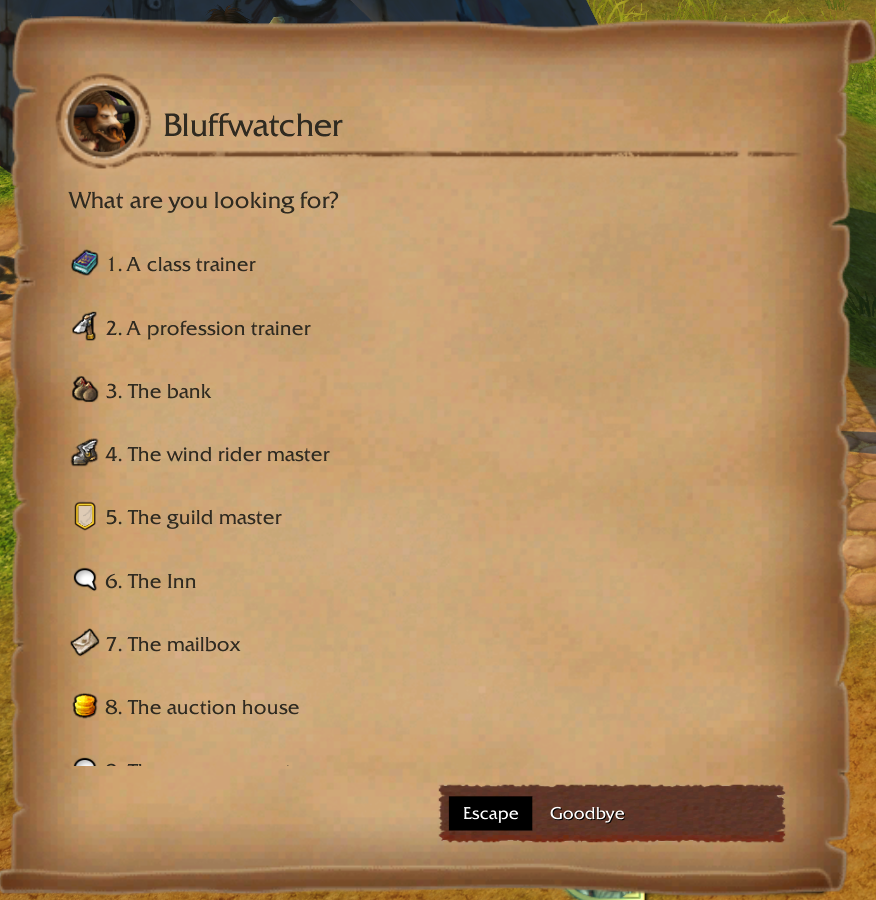
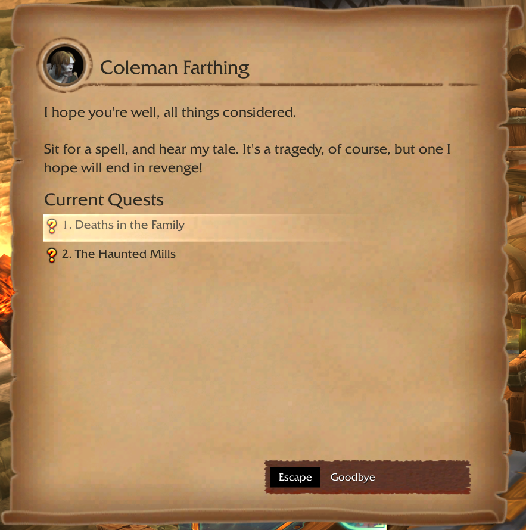
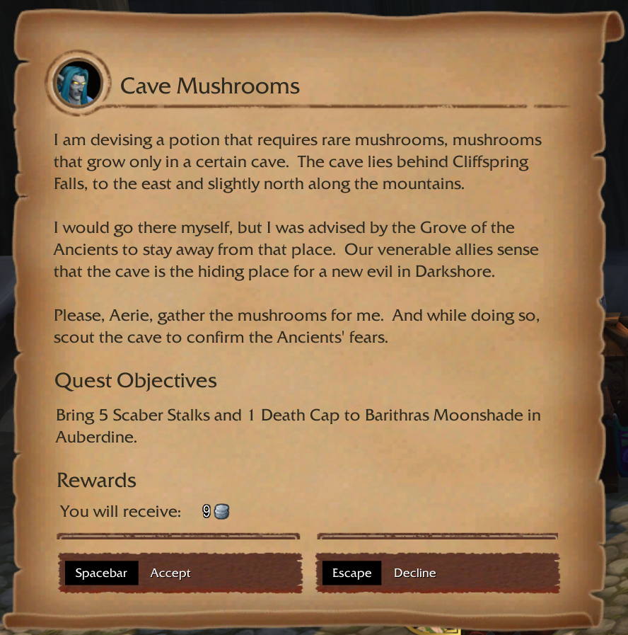
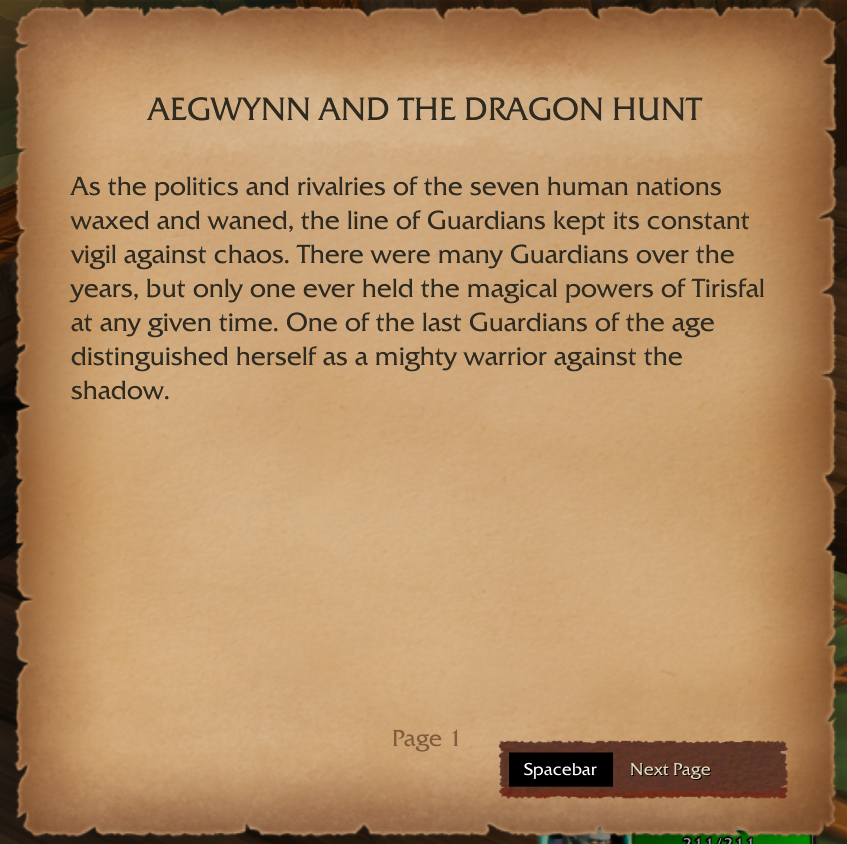

# DialogUI Classic

Disclaimer:
This addon was initially created as a learning project to explore WoW addon development.
It is provided as-is, without warranty or support.
The author is not responsible for any issues, including errors, data loss, or usage on any public or private servers.
Use at your own risk.

It received an intense beautification to create visuals similar to the inspiring example Dialogue UI. This version received a replacement of the standard book frame, which is also inspired by the original addon for retail WoW.

Users are welcome to use, modify, or explore the code for educational purposes.
Redistribution is allowed, but the author assumes no responsibility for any consequences.

This addon is designed for WoW Vanilla 1.12.1. Compatibility with other versions or custom servers is not guaranteed.

# Customize it!

Feel free to add/remove icons or change the frame background completely, every image is now Truevision Graphics Adapter (TGA) format.

I recommend using Gimp 3 with [Batcher](https://kamilburda.github.io/batcher/) to quickly export your new files.

To change the gossip icons you can go to :

> DialogUIClassic/src/assets/art/icons/GossipIcons.xcf

To change the style of the buttons or of the frame :

> DialogUIClassic/src/assets/art/parchment/ParchmentLayout.xcf

# Gallery

[DialogueUI](https://www.curseforge.com/wow/addons/dialogueui) was obviously the inspiration for this new look.
